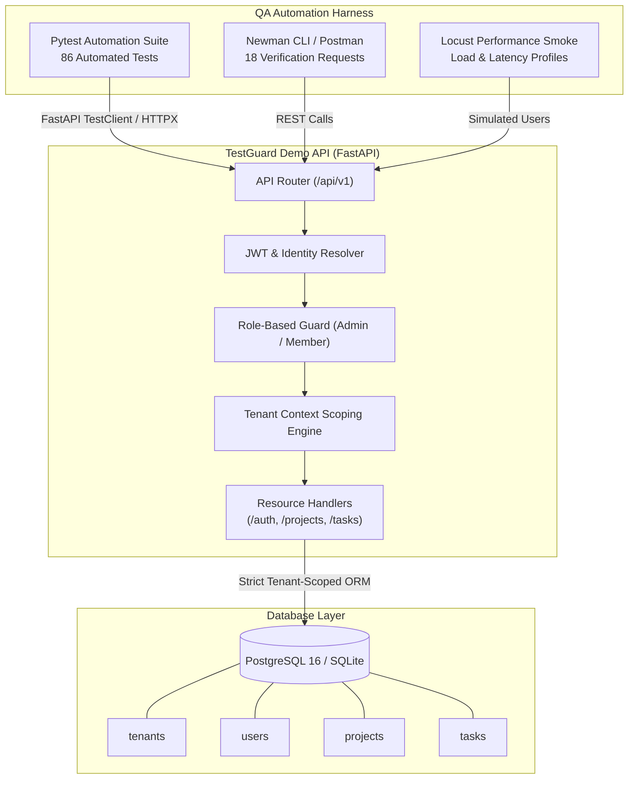

# TestGuard - Automated API Quality & Security Testing Framework

[](https://github.com/monourhosan/TestGuard/actions/workflows/ci.yml)
[](https://www.python.org/)
[](https://fastapi.tiangolo.com/)
[-success.svg)](tests/)
[](reports/)
[](compose.yaml)
[](LICENSE)

> **Enterprise-grade API quality assurance and security verification framework demonstrating structured, automated API testing for a multi-tenant SaaS REST API.**

---

## 1. Project Overview

**TestGuard** is a portfolio-ready QA automation framework that illustrates how modern software quality engineers test, validate, and harden multi-tenant cloud APIs.

The repository contains two decoupled subsystems:
1. **The System Under Test (SUT):** A production-structured multi-tenant SaaS project and task management REST API built with **FastAPI**, **SQLAlchemy 2.x**, **Pydantic v2**, and **PostgreSQL**.
2. **The QA Automation Suite:** A test suite built with **Pytest**, **FastAPI TestClient**, **HTTPX**, **Postman/Newman**, and **Locust** designed to catch regressions, authorization bypasses, relational integrity defects, and cross-tenant data leaks.

> [!NOTE]
> **Defensive Security & Educational Notice:** TestGuard demonstrates structured QA verification, negative testing, and defensive authorization validation. It is designed as a technical portfolio project and does not claim to be a certified commercial security tool.

---

## 2. Why TestGuard Exists

In multi-tenant SaaS architectures, authorization bugs and data leakages between organizations (**Insecure Direct Object Reference / IDOR**) represent critical security and business liabilities. Standard unit tests frequently overlook:
- Horizontal privilege escalation (Tenant A reading or mutating Tenant B's data).
- Relational integrity breaches (attaching a task to a project owned by a rival tenant).
- Token tampering and claim forgery.
- Stale session / expired token replay attacks.
- Information disclosure via differential HTTP status codes (leaking resource existence via 403 vs 404).

TestGuard was engineered to demonstrate how a senior QA automation engineer prevents these vulnerabilities through layered, automated testing at the API, database, and CI levels.

---

## 3. Architecture & System Design



---

## 4. Key QA Capabilities

- **Multi-Tenant Isolation Verification:** Rigorous verification with at least two isolated tenants in all test suites to guarantee zero cross-tenant leakage.
- **Anti-Enumeration Defense:** Cross-tenant resource queries return a consistent `404 Not Found` rather than `403 Forbidden`, preventing attackers from enumerating valid private IDs.
- **Role-Based Access Control (RBAC):** Strict enforcement of Admin vs. Member roles, validated against privilege escalation and forged token claims.
- **Composite Database Integrity Constraints:** Database-level composite foreign key `(project_id, tenant_id)` enforces relational isolation at the engine level.
- **Deterministic Seed Fixtures:** Repeatable database seeding generating isolated sample tenants, users, projects, and tasks.
- **Production Database Safety Guard:** Automated runtime check blocking test execution against any database URL that does not explicitly designate a test environment.
- **Automated CI/CD Integration:** GitHub Actions workflow with PostgreSQL service container, Ruff linting, migrations, coverage, and JUnit artifact publication.

---

## 5. Technology Stack

| Domain | Technology | Purpose |
| :--- | :--- | :--- |
| **Language** | Python 3.11+ / 3.12 | Primary application and test runtime |
| **Demo REST API** | FastAPI 0.115+ | High-performance asynchronous REST API framework |
| **Data Validation** | Pydantic v2 | Strict schema, constraint, and payload validation |
| **ORM & Relational DB** | SQLAlchemy 2.x & PostgreSQL 16 | Relational data persistence with composite foreign keys |
| **Migrations** | Alembic 1.13+ | Database schema versioning and DDL migrations |
| **Authentication** | PyJWT & Bcrypt | Cryptographic JWT access tokens and hashed passwords |
| **Test Framework** | Pytest 8.x | Test orchestration, parameterization, and fixtures |
| **HTTP Clients** | HTTPX & FastAPI TestClient | Black-box and in-process API testing |
| **Exploration / Manual API** | Postman Collection v2.1 | Visual API exploration and exploratory testing |
| **CLI API Testing** | Newman | Headless execution of Postman collections in CI/local |
| **Code Coverage** | pytest-cov (Coverage 7.x) | Line-by-line coverage measurement and HTML reporting |
| **Code Quality & Linting** | Ruff 0.6+ | Ultra-fast linter and formatter |
| **Performance Testing** | Locust 2.47+ | Lightweight latency and load smoke testing |
| **Containerization** | Docker & Docker Compose | Multi-container reproducible local and CI deployment |
| **CI/CD** | GitHub Actions | Automated build, lint, database migration, and test matrix |

---

## 6. Repository Structure

```text
testguard/
├── .github/
│   └── workflows/
│       └── ci.yml             # GitHub Actions CI workflow with PostgreSQL service
├── alembic/                   # Database migration environment
│   ├── versions/              # Versioned schema migrations (001_initial_schema.py)
│   └── env.py                 # Dynamic Alembic environment config
├── app/                       # Demo API: System Under Test (SUT)
│   ├── api/
│   │   └── v1/                # Versioned API routes (/auth, /projects, /tasks)
│   ├── core/                  # Settings, Security (Bcrypt/JWT), Exceptions, Dependencies
│   ├── db/                    # SQLAlchemy engine, session maker, base model
│   ├── models/                # ORM entities (Tenant, User, Project, Task, Enums)
│   ├── schemas/               # Pydantic validation schemas
│   ├── main.py                # FastAPI app factory, CORS, exception handlers, /health
│   └── seed.py                # Deterministic, repeatable multi-tenant database seeder
├── tests/                     # Automated QA Suite
│   ├── conftest.py            # Safety checks, DB transaction lifecycle, fixtures, seed data
│   ├── api/                   # Health check, project CRUD, task CRUD validation tests
│   ├── auth/                  # Authentication, JWT validation, token tampering tests
│   ├── authorization/         # Role-based access control (Admin vs. Member) tests
│   ├── tenancy/               # Multi-tenant isolation and anti-enumeration tests
│   ├── database/              # Relational persistence, cascade deletes, composite FK tests
│   ├── regression/            # Critical regression safety net
│   └── performance/           # Latency and sequential throughput smoke tests
├── test_cases/
│   ├── test_case_matrix.md    # Comprehensive manual and automated test catalog
│   └── traceability_matrix.md # Requirements-to-test traceability matrix
├── bug_reports/
│   ├── README.md              # Defect lifecycle, severity vs. priority guidelines
│   ├── bug_report_template.md # Professional QA defect template
│   └── examples/              # Simulated IDOR defect report with regression link
├── docs/
│   ├── architecture.md        # Technical architecture, ERD, and component diagrams
│   ├── test_strategy.md       # QA testing pyramid, methodology, and data management
│   ├── api_reference.md       # Complete REST API endpoint reference and status codes
│   ├── database_validation.md # Relational integrity, constraints, and safety guard docs
│   └── decisions.md           # Architecture Decision Records (ADR-001 to ADR-006)
├── postman/
│   ├── TestGuard.postman_collection.json         # Complete 18-request Postman test suite
│   └── TestGuard.local.postman_environment.json  # Pre-configured demo environment
├── reports/                   # Generated reports (JUnit XML, HTML coverage, test results)
├── scripts/
│   ├── run_tests.py           # Cross-platform test suite runner
│   └── run_postman.py         # Automated server boot and Newman runner
├── compose.yaml               # Docker Compose configuration (PostgreSQL + FastAPI)
├── Dockerfile                 # Multi-stage production container image
├── locustfile.py              # Performance smoke test scenario
├── pyproject.toml             # Project dependencies, Ruff, Pytest, and Coverage config
├── requirements.txt           # Pinned dependency requirements
└── README.md                  # Project presentation and documentation
```

---

## 7. Role-Based Access Control (RBAC) Matrix

| Action | Admin | Member | Anonymous | Enforced Status Code |
| :--- | :---: | :---: | :---: | :---: |
| **View projects in own tenant** | Yes | Yes | No | `200 OK` / `401 Unauthorized` |
| **Create project in own tenant** | Yes | No | No | `201 Created` / `403 Forbidden` |
| **Update project in own tenant** | Yes | No | No | `200 OK` / `403 Forbidden` |
| **Delete project in own tenant** | Yes | No | No | `200 OK` / `403 Forbidden` |
| **View tasks in own tenant** | Yes | Yes | No | `200 OK` / `401 Unauthorized` |
| **Create task in own tenant** | Yes | Yes | No | `201 Created` / `401 Unauthorized` |
| **Update task in own tenant** | Yes | Yes | No | `200 OK` / `401 Unauthorized` |
| **Delete task in own tenant** | Yes | No | No | `200 OK` / `403 Forbidden` |
| **Access another tenant's records** | **No** | **No** | **No** | **`404 Not Found` (Zero Leakage)** |

---

## 8. Multi-Tenant Data Isolation Strategy

1. **Context Extraction:** Every request resolves `current_user` from the cryptographically verified JWT bearer token. The caller's `tenant_id` is bound exclusively from the database record associated with the token.
2. **Payload Protection:** Any client-supplied `tenant_id` included in request bodies or query parameters is rejected or strictly overridden by the token's authenticated tenant.
3. **Database Query Scoping:** Every select, update, and delete query explicitly filters by `tenant_id == current_user.tenant_id`.
4. **Relational Composite Foreign Key:** The `tasks` table includes a composite constraint `FOREIGN KEY (project_id, tenant_id) REFERENCES projects(id, tenant_id) ON DELETE CASCADE`. It is mathematically impossible at the SQL engine level to attach a task to a project in another tenant.
5. **Anti-Enumeration Response Codes:** Attempting to read, update, or delete a foreign tenant's record returns `404 Not Found` (identical to querying a nonexistent ID) rather than `403 Forbidden`. This eliminates information disclosure vulnerabilities where attackers probe for valid IDs.

---

## 9. Setup & Installation

### Prerequisites
- Python 3.11 or Python 3.12
- Git
- Optional: Docker & Docker Compose (for PostgreSQL containerization)
- Optional: Node.js & npm (for Newman CLI execution)

### 9.1 Local Setup

```bash
# 1. Clone repository
git clone https://github.com/monourhosan/TestGuard.git
cd TestGuard

# 2. Create virtual environment
python -m venv .venv

# On Linux / macOS:
source .venv/bin/activate
# On Windows (PowerShell):
.venv\Scripts\Activate.ps1

# 3. Install dependencies
pip install --upgrade pip
pip install -r requirements.txt
pip install -e .

# 4. Configure environment
cp .env.example .env
```

### 9.2 Running with Docker Compose

To start the PostgreSQL database and FastAPI demo application together:

```bash
# Start containers in detached mode
docker compose up -d

# Verify container health
docker compose ps

# View service logs
docker compose logs -f api

# Stop containers
docker compose down

# Stop containers and reset local database volume
docker compose down -v
```

---

## 10. Database Migrations & Seeding

### Apply Alembic Migrations
```bash
alembic upgrade head
```

### Seed Demo Data (Repeatable & Idempotent)
```bash
python app/seed.py
```

### Pre-Seeded Demo Accounts

> [!CAUTION]
> These credentials are strictly for local demonstration and automated testing. Never reuse them in production environments.

| Organization | Role | Email | Password | Pre-seeded Resources |
| :--- | :--- | :--- | :--- | :--- |
| **Tenant Alpha** (`acme`) | Admin | `admin@alpha.com` | `AdminPassword123!` | 2 Projects, 2 Tasks |
| **Tenant Alpha** (`acme`) | Member | `member@alpha.com` | `MemberPassword123!` | (Shares Alpha data) |
| **Tenant Alpha** (`acme`) | Inactive | `inactive@alpha.com` | `InactivePassword123!` | Deactivated account |
| **Tenant Beta** (`globex`) | Admin | `admin@beta.com` | `AdminPassword123!` | 1 Project, 1 Task |
| **Tenant Beta** (`globex`) | Member | `member@beta.com` | `MemberPassword123!` | (Shares Beta data) |

---

## 11. Automated Test Execution

### 11.1 Pytest Suite Execution

```bash
# Run all 86 automated tests
pytest -v

# Run with line-by-line coverage report
pytest --cov=app --cov-report=term-missing

# Run and generate JUnit XML + self-contained HTML report
pytest -v --junitxml=reports/junit.xml --html=reports/report.html --self-contained-html
```

### 11.2 Targeted Suite Execution

```bash
# Authentication tests only
pytest tests/auth -v

# Role-based authorization tests only
pytest tests/authorization -v

# Multi-tenant isolation tests only
pytest tests/tenancy -v

# Relational database integrity tests only
pytest tests/database -v

# Critical regression safety suite only
pytest tests/regression -v

# Performance latency smoke tests only
pytest tests/performance -v
```

### 11.3 Cross-Platform Test Runner Script
You can also use the bundled Python runner:
```bash
python scripts/run_tests.py --suite all --cov --xml --html
python scripts/run_tests.py --suite tenancy
python scripts/run_tests.py --suite authz
```

---

## 12. Actual Observed Test Results

The following test execution metrics were observed on the test environment:

```text
============================= test session starts =============================
platform win32 -- Python 3.11.18, pytest-9.2.0, pluggy-1.7.0
rootdir: D:\project\TestGuard
configfile: pyproject.toml
testpaths: tests
plugins: anyio-4.15.1, locust-2.47.0, cov-7.1.0, html-4.2.0, metadata-3.1.1
collected 86 items

tests/api/test_health.py .................................. [  2%]
tests/api/test_projects.py ................................ [ 18%]
tests/api/test_tasks.py ................................... [ 33%]
tests/auth/test_authentication.py ......................... [ 47%]
tests/authorization/test_authorization.py ................. [ 63%]
tests/database/test_database_integrity.py ................. [ 75%]
tests/performance/test_performance_smoke.py ............... [ 77%]
tests/regression/test_regression.py ....................... [ 86%]
tests/tenancy/test_tenant_isolation.py .................... [100%]

=============================== tests coverage ================================
Name                               Stmts   Miss  Cover   Missing
----------------------------------------------------------------
app\api\v1\endpoints\auth.py          26      0   100%
app\api\v1\endpoints\projects.py      71      3    96%   104, 116, 154
app\api\v1\endpoints\tasks.py         71      4    94%   112, 124, 129, 146
app\api\v1\router.py                   6      0   100%
app\core\config.py                    25      2    92%   40, 43
app\core\deps.py                      46      6    87%   37, 48, 55, 69-71
app\core\exceptions.py                20      2    90%   40, 48
app\core\security.py                  23      2    91%   21-22
app\db\base.py                         3      0   100%
app\db\session.py                     23     10    57%   10, 15-19, 30-34
app\main.py                           20      4    80%   48-55
app\models\__init__.py                 7      0   100%
app\models\enums.py                   11      0   100%
app\models\project.py                 18      0   100%
app\models\task.py                    19      0   100%
app\models\tenant.py                  14      0   100%
app\models\user.py                    17      0   100%
app\schemas\__init__.py                7      0   100%
app\schemas\auth.py                   14      0   100%
app\schemas\common.py                 13      0   100%
app\schemas\project.py                26      0   100%
app\schemas\task.py                   24      0   100%
app\schemas\tenant.py                 11      0   100%
app\schemas\user.py                   20      0   100%
----------------------------------------------------------------
TOTAL                                535     33    94%
================== 86 passed, 3 warnings in 87.78s ==================
```

---

## 13. Postman & Newman CLI Testing

### Import Collection in Postman
1. Open the Postman desktop application.
2. Click **Import** in the top left.
3. Select `postman/TestGuard.postman_collection.json`.
4. Select `postman/TestGuard.local.postman_environment.json`.
5. Ensure the active environment is set to `TestGuard Local Environment`.

### Run via Newman CLI
TestGuard provides an automated runner that boots the local API, seeds data, executes Newman via `npx`, and cleans up:

```bash
python scripts/run_postman.py
```

Or execute directly with Newman:
```bash
npx newman run postman/TestGuard.postman_collection.json \
  -e postman/TestGuard.local.postman_environment.json
```

---

## 14. Performance Smoke Testing

Locust is configured for lightweight, non-destructive read-heavy smoke testing:

```bash
# Run headless performance smoke test for 15 seconds with 5 simulated users
locust -f locustfile.py --headless -u 5 -r 1 -t 15s --host http://localhost:8000
```

Or open the interactive web UI:
```bash
locust -f locustfile.py --host http://localhost:8000
# Open http://localhost:8089 in your browser
```

---

## 15. Continuous Integration (GitHub Actions)

The workflow defined in `.github/workflows/ci.yml` runs automatically on pushes and pull requests:
1. Provisions an isolated **PostgreSQL 16** service container with automated healthcheck.
2. Checks out the repository and configures **Python 3.11**.
3. Installs dependencies and verifies formatting with **Ruff**.
4. Applies database schema migrations via **Alembic**.
5. Executes the complete 86-test Pytest suite.
6. Publishes **JUnit XML**, **HTML coverage report**, and **report.html** as workflow artifacts.

---

## 16. QA Artifacts & Documentation Links

- [Test Case Matrix](test_cases/test_case_matrix.md): Exhaustive table of 86 test cases (`AUTH-xxx`, `AUTHZ-xxx`, `TENANT-xxx`, `API-xxx`, `DB-xxx`, `REG-xxx`).
- [Requirements Traceability Matrix (RTM)](test_cases/traceability_matrix.md): Bidirectional mapping of specifications to test cases.
- [Bug Reporting Guidelines](bug_reports/README.md): Defect lifecycle, severity vs. priority guidelines.
- [Bug Report Template](bug_reports/bug_report_template.md): Standardized QA bug report format.
- [Simulated IDOR Defect Report](bug_reports/examples/BUG-SIM-001_cross_tenant_enumeration.md): Sample defect documentation.
- [Architecture & ERD](docs/architecture.md): Deep-dive into technical architecture and entity models.
- [Database Validation & Integrity](docs/database_validation.md): Relational constraints and safety guards.
- [Architecture Decision Records (ADRs)](docs/decisions.md): Record of engineering and architectural decisions.

---

## 17. Known Limitations & Future Improvements

- **Email Delivery Service:** In this portfolio demo, password resets and account verification emails are simulated; integration with SendGrid/AWS SES would be a valuable extension.
- **Refresh Token Rotation:** The authentication subsystem utilizes short-lived JWT access tokens; implementing refresh token rotation and redis token blacklisting would further enhance security.
- **Audit Logging Subsystem:** Future work could introduce a centralized immutable audit log capturing all tenant authorization events.
# TestGuard

