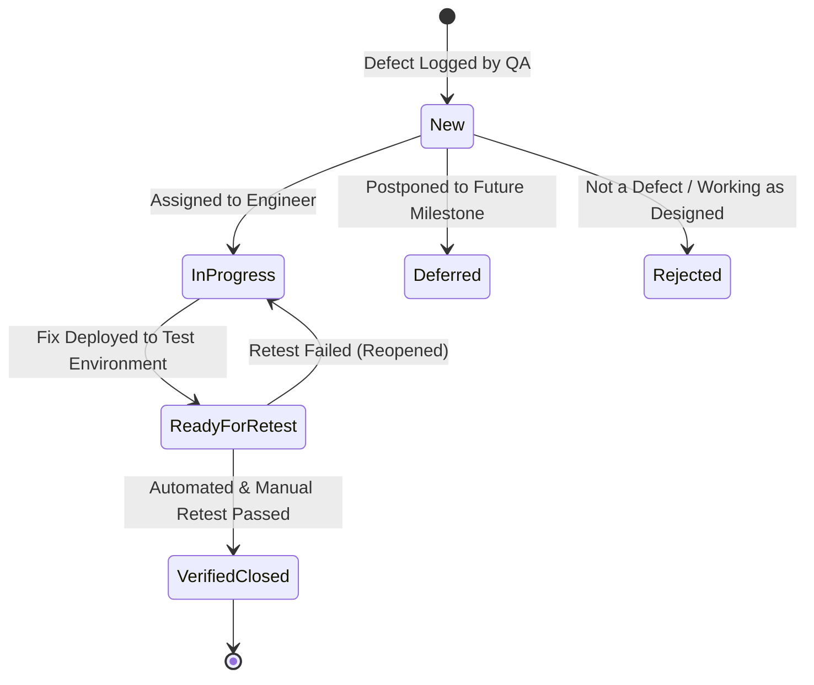

# TestGuard Defect & Bug Reporting Standards

This directory establishes the formal QA defect tracking protocol, taxonomy, and templates used within the TestGuard project.

---

## 1. Severity vs. Priority: Definitions and Guidelines

A critical distinction in professional QA engineering is the difference between **Severity** (technical impact) and **Priority** (business urgency).

### Severity: The Technical Impact
Severity reflects the extent of technical disruption, data integrity risk, or security violation that the defect causes to the system, irrespective of business schedules.

- **Critical:**
  - Complete system crash or unavailability.
  - Data corruption or permanent data loss.
  - Security vulnerability: Unauthorized cross-tenant data exposure (Horizontal Privilege Escalation / IDOR), unauthenticated access to protected data, or plaintext password storage.
- **Major:**
  - A primary feature or critical API workflow is broken with no available workaround.
  - Incorrect database state changes occurring during normal transactions.
- **Moderate:**
  - A non-critical feature fails, or an edge-case validation error occurs, but a reasonable workaround exists.
  - Flawed error status codes (e.g., returning 500 instead of 422 for malformed input).
- **Minor:**
  - Cosmetic defects, documentation typos, or non-standard formatting in error response messages that do not affect functionality.

### Priority: The Business Urgency
Priority defines the order in which engineering resources must address and resolve the issue, driven by release schedules, business impact, and user exposure.

- **P1 (Immediate / Blocker):** Must be resolved immediately before any further code deployment or release can proceed.
- **P2 (High):** Must be resolved in the current sprint / release iteration.
- **P3 (Normal):** Scheduled for resolution during regular development cycles.
- **P4 (Low):** Minor enhancement or cosmetic fix resolved when convenient or backlogged.

### Example Contrasts
- **High Severity, Low Priority:** An unauthenticated buffer overflow on a deprecated endpoint that is disabled in production and scheduled for removal next week.
- **Low Severity, High Priority:** The company logo or tenant display name is misspelled on the main login screen seen by all enterprise clients.

---

## 2. Defect Lifecycle

---

## 3. Structure of This Directory
- `bug_report_template.md`: Canonical template for reporting defects.
- `examples/`: Realistic simulated bug reports demonstrating proper usage of the template.
  - `BUG-SIM-001_cross_tenant_enumeration.md`: Simulated example demonstrating how an authorization / data-leak defect is captured, documented, and traced to regression tests.
