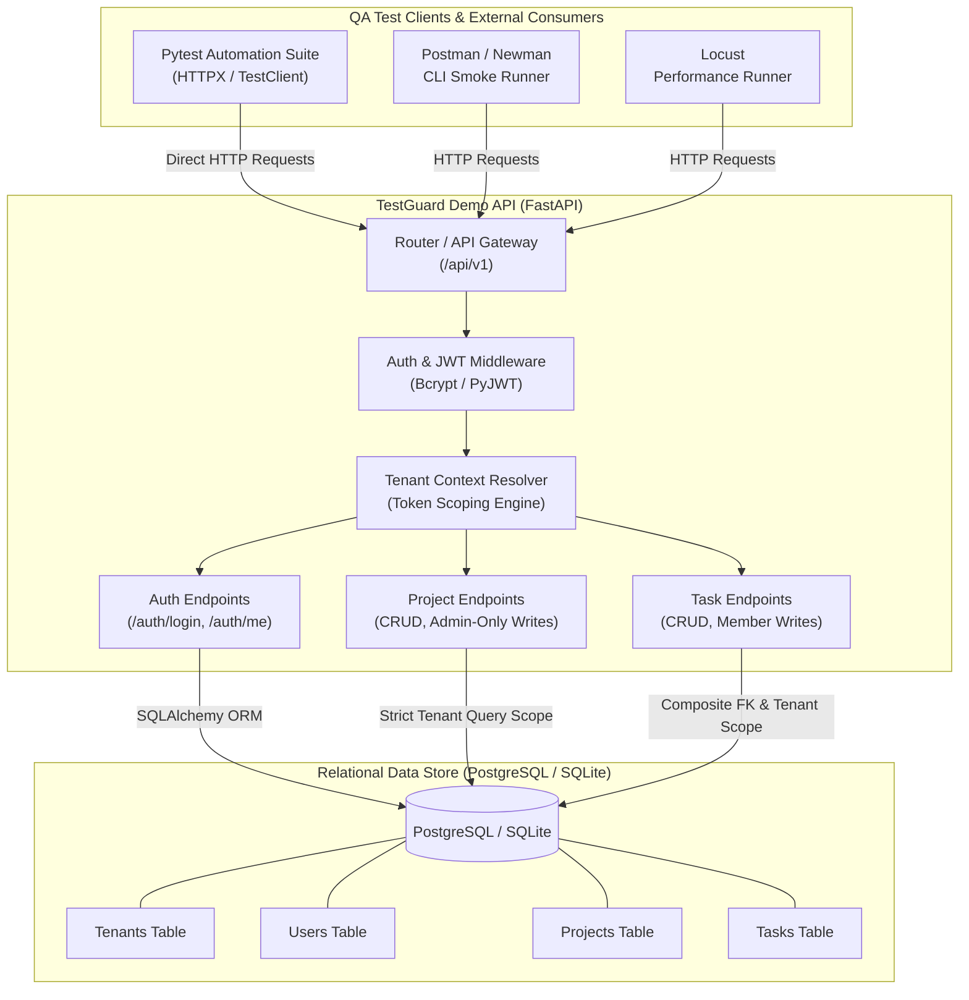
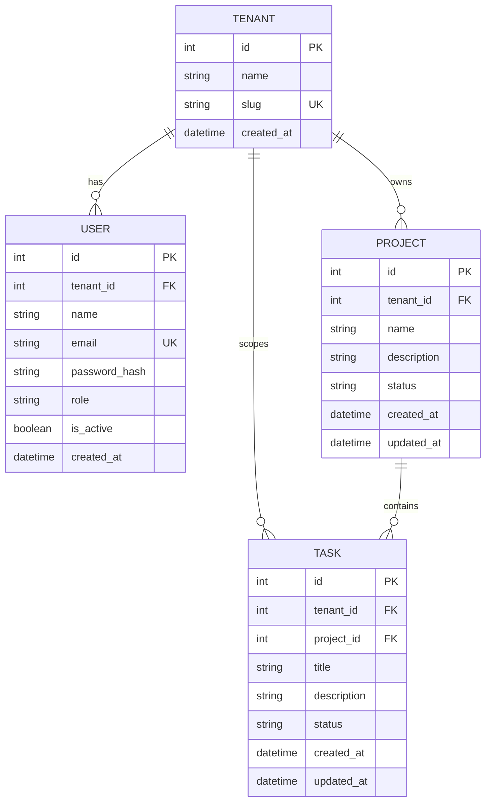

# TestGuard System Architecture

TestGuard is an automated API quality assurance and security verification framework designed to demonstrate end-to-end testing of a multi-tenant SaaS REST API.

---

## 1. High-Level Architecture Diagram

---

## 2. Core Architectural Pillars

### 2.1 Multi-Tenant Data Isolation Model
The core security objective of TestGuard is strict isolation between tenant environments:
1. **Server-Side Identity:** The tenant context is extracted strictly from the verified JWT `sub` and `tenant_id` claims, loaded from the database by `get_current_user`.
2. **Payload Immunity:** Any client-supplied `tenant_id` in query parameters or JSON request bodies is completely ignored or validated to match the token context.
3. **Query Scoping:** All database operations for projects and tasks append `WHERE tenant_id = :authenticated_tenant_id`.
4. **Zero Information Disclosure:** Querying, updating, or deleting a resource belonging to another tenant returns `HTTP 404 Not Found` rather than `403 Forbidden`, preventing resource enumeration (Insecure Direct Object Reference / IDOR).
5. **Relational Constraints:** The tasks table enforces a composite foreign key `(project_id, tenant_id) REFERENCES projects(id, tenant_id)`, ensuring at the database engine level that no task can ever be attached to a project in another organization.

---

### 2.2 Role-Based Access Control (RBAC) Matrix

| User Role | View Projects | Create Project | Update Project | Delete Project | View Tasks | Create Task | Update Task | Delete Task |
| :--- | :---: | :---: | :---: | :---: | :---: | :---: | :---: | :---: |
| **Admin** | Yes | Yes | Yes | Yes | Yes | Yes | Yes | Yes |
| **Member** | Yes | No (403) | No (403) | No (403) | Yes | Yes | Yes | No (403) |
| **Anonymous** | No (401) | No (401) | No (401) | No (401) | No (401) | No (401) | No (401) | No (401) |

---

### 2.3 Entity Relationship Diagram (ERD)

