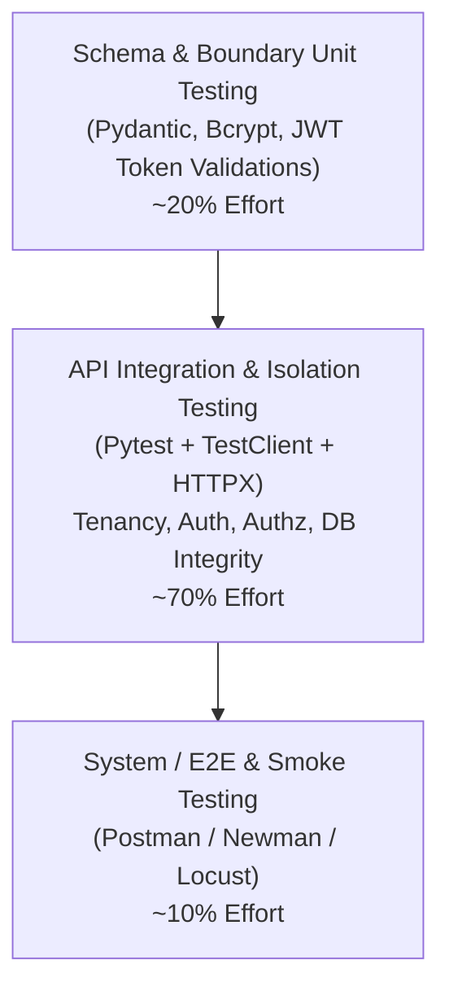

# TestGuard Quality Assurance & Test Strategy

This document details the test strategy, testing pyramid, methodologies, and execution protocols governing TestGuard.

---

## 1. Testing Pyramid & QA Philosophy

TestGuard adopts a modern QA automation pyramid structured to maximize coverage, execution speed, and deterministic reproducibility:

---

## 2. Test Classification & Objectives

### 2.1 Authentication Testing (`tests/auth/`)
- **Objective:** Verify robust cryptographic token issuance and verification.
- **Key Scenarios:**
  - Password hashing with Bcrypt (never plaintext).
  - Rejection of incorrect credentials, deactivated accounts, and malformed emails.
  - Rejection of tampered signatures (RFC 7518 compliance) and expired tokens.
  - Zero leakage of password hashes in any API response.

### 2.2 Authorization Testing (`tests/authorization/`)
- **Objective:** Enforce the principle of least privilege across application roles.
- **Key Scenarios:**
  - Admin users can execute full CRUD on projects and tasks.
  - Member users are restricted to read-only on projects and read/write on tasks (cannot delete tasks or manage projects).
  - Defense against JWT token claim tampering (forged `role: admin` rejected by database verification).

### 2.3 Multi-Tenant Isolation Testing (`tests/tenancy/`)
- **Objective:** Prevent Horizontal Privilege Escalation and cross-tenant data leaks.
- **Key Scenarios:**
  - Verified with at least two isolated tenants in fixtures (Tenant Alpha & Tenant Beta).
  - Zero IDOR leakage: cross-tenant GET, PATCH, and DELETE return 404 Not Found.
  - Query scoping: List endpoints return mutually disjoint sets.
  - Task creation cannot reference a foreign tenant project ID.
  - Pagination totals never count rows from other tenants.

### 2.4 Functional & Validation Testing (`tests/api/`)
- **Objective:** Verify API contracts, data types, and boundary conditions.
- **Key Scenarios:**
  - Rejection of empty strings, whitespace-only strings, and strings exceeding max length.
  - Safe pagination defaults (page=1, size=10) and boundary limits (size <= 100, page >= 1).
  - Uniqueness constraints enforced per-tenant while allowing duplicate names across different tenants.

### 2.5 Database Integrity Testing (`tests/database/`)
- **Objective:** Verify data persistence, foreign keys, cascades, and transaction boundaries.
- **Key Scenarios:**
  - Foreign key and composite foreign key constraint enforcement.
  - Cascade deletions: removing a project purges all child tasks.
  - Atomic rollbacks: failed operations leave zero partial or orphaned rows.
  - Production database safety check preventing execution against non-test instances.

### 2.6 Regression Testing (`tests/regression/`)
- **Objective:** Provide a defensive safety net against high-risk regressions.
- **Key Scenarios:**
  - Blocked cross-tenant access.
  - Member role restrictions.
  - SQL injection vectors across paths and parameters.
  - Inactive account revocation.

---

## 3. Test Data Management
- Tests are completely self-contained and deterministic.
- No dependency on external third-party services or the public internet.
- Each test runs inside an isolated database transaction with automatic rollback and nested savepoints.
